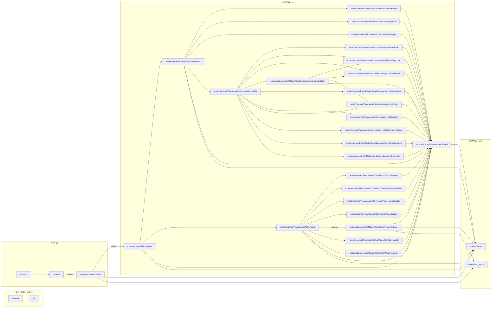

# Architecture

> Generated from the code by `npm run arch:build`. Everything between the `arch:generated` markers is rewritten on every build. Claude maintains the Conventions section at the end; the generator leaves it alone.

<!-- arch:generated:start -->

## 1. Overview

| Plane | Thread | Modules | Holds |
|---|---|---|---|
| AUDIO | audio | 0 | mic capture, playback, DSP, onset and pitch detection (native audio thread) |
| SYNC | any | 0 | shared clock, latency compensation, event stream (lock-free) |
| MOTION | ui | 25 | animation drivers, scenes and rendering (UI thread + GPU) |
| SHARED | any | 2 | types, utilities and music-theory tables usable from any thread |
| PLATFORM | native | 2 | iOS and Android projects and native modules |
| APP | js | 3 | screens, navigation, lessons, scoring, progress, storage (JS thread) |

**No problems.** Every rule passes, every module has a purpose, and every flow matches the code.

## 2. Modules

| Module | Kind | Plane | Thread | Purpose | Uses | Used by |
|---|---|---|---|---|---|---|
| `App.tsx` | entry | app | js | Root component: safe-area provider, hidden status bar and the lesson screen, full screen in landscape. | `screens/LessonScreen` | `index.js` |
| `android` | platform | platform | native | Android app project: Gradle build, MainActivity, manifest and native Android code | — | — |
| `index.js` | entry | app | js | Native entry point: registers the root App component with React Native. | `App.tsx` | — |
| `ios` | platform | platform | native | iOS app project: Xcode project, AppDelegate, Info.plist and native iOS code | — | — |
| `motion/scenes/PianoMaster` | scene | motion | ui | The piano's single source of truth on screen, in two parts: CorePiano (the keyboard, any range: 48 keys by default, 88, 108 or any other) and CoreNotes (the sheet music above it). Also owns the key state (which keys are lit, in which role) that lessons and the mic write to on the UI thread. | `motion/scenes/PianoMaster/CoreNotes`, `motion/scenes/PianoMaster/CorePiano`, `motion/scenes/PianoMaster/shared`, `shared/piano` | `screens/LessonScreen` |
| `motion/scenes/PianoMaster/CoreNotes` | module | motion | ui | The sheet music above the piano, drawn with Skia and SMuFL music fonts: the music symbols (one folder each under symbols/), the score that places notes and rests on the staff, and the lesson design's own parts (staff paper, duration bars, playhead). | `motion/scenes/PianoMaster/CoreNotes/DurationBar`, `motion/scenes/PianoMaster/CoreNotes/Playhead`, `motion/scenes/PianoMaster/CoreNotes/StaffPaper`, `motion/scenes/PianoMaster/CoreNotes/symbols`, `motion/scenes/PianoMaster/shared`, `shared/piano` | `motion/scenes/PianoMaster` |
| `motion/scenes/PianoMaster/CoreNotes/DurationBar` | module | motion | ui | The duration bar: the see-through bar after a note showing how long to hold it. Part of the lesson design, not a music symbol. | `motion/scenes/PianoMaster/shared` | `motion/scenes/PianoMaster/CoreNotes` |
| `motion/scenes/PianoMaster/CoreNotes/Playhead` | module | motion | ui | The playhead: the big see-through vertical line marking where the music is now. Part of the lesson design, not a music symbol. | `motion/scenes/PianoMaster/shared` | `motion/scenes/PianoMaster/CoreNotes` |
| `motion/scenes/PianoMaster/CoreNotes/StaffPaper` | module | motion | ui | The white paper strip behind the staff, with its soft shadow: part of the lesson design, not a music symbol. | `motion/scenes/PianoMaster/shared` | `motion/scenes/PianoMaster/CoreNotes` |
| `motion/scenes/PianoMaster/CoreNotes/symbols` | module | motion | ui | The music notation symbols, one folder each and named as in music: Staff (the 5 lines), SystemicBarline, Barline, TrebleClef, TimeSignature, Notehead, Stem, LedgerLine, QuarterNote (notehead + stem) and QuarterRest. Each draws on its own, to be reused by any component. | `motion/scenes/PianoMaster/CoreNotes/symbols/Barline`, `motion/scenes/PianoMaster/CoreNotes/symbols/LedgerLine`, `motion/scenes/PianoMaster/CoreNotes/symbols/Notehead`, `motion/scenes/PianoMaster/CoreNotes/symbols/QuarterNote`, `motion/scenes/PianoMaster/CoreNotes/symbols/QuarterRest`, `motion/scenes/PianoMaster/CoreNotes/symbols/Staff` +4 | `motion/scenes/PianoMaster/CoreNotes` |
| `motion/scenes/PianoMaster/CoreNotes/symbols/Barline` | module | motion | ui | The single barline: the vertical line that separates two measures. | `motion/scenes/PianoMaster/shared` | `motion/scenes/PianoMaster/CoreNotes/symbols` |
| `motion/scenes/PianoMaster/CoreNotes/symbols/LedgerLine` | module | motion | ui | The ledger line: the short line through or under a notehead above or below the staff, such as middle C on a treble staff. | `motion/scenes/PianoMaster/shared` | `motion/scenes/PianoMaster/CoreNotes/symbols`, `motion/scenes/PianoMaster/CoreNotes/symbols/QuarterNote` |
| `motion/scenes/PianoMaster/CoreNotes/symbols/Notehead` | module | motion | ui | The notehead: the filled oval of a note, centred on the note's line or space, and where a stem meets it. | `motion/scenes/PianoMaster/shared` | `motion/scenes/PianoMaster/CoreNotes/symbols`, `motion/scenes/PianoMaster/CoreNotes/symbols/QuarterNote` |
| `motion/scenes/PianoMaster/CoreNotes/symbols/QuarterNote` | module | motion | ui | The quarter note: a notehead and a stem, with ledger lines when it sits above or below the staff; drawn in ink, or see-through red when it is the note to play now. | `motion/scenes/PianoMaster/CoreNotes/symbols/LedgerLine`, `motion/scenes/PianoMaster/CoreNotes/symbols/Notehead`, `motion/scenes/PianoMaster/CoreNotes/symbols/Stem`, `motion/scenes/PianoMaster/shared` | `motion/scenes/PianoMaster/CoreNotes/symbols` |
| `motion/scenes/PianoMaster/CoreNotes/symbols/QuarterRest` | module | motion | ui | The quarter rest: one beat of silence, on the middle line of the staff. | `motion/scenes/PianoMaster/shared` | `motion/scenes/PianoMaster/CoreNotes/symbols` |
| `motion/scenes/PianoMaster/CoreNotes/symbols/Staff` | module | motion | ui | The staff: the 5 horizontal lines music is written on, and how far they reach. | `motion/scenes/PianoMaster/shared` | `motion/scenes/PianoMaster/CoreNotes/symbols` |
| `motion/scenes/PianoMaster/CoreNotes/symbols/Stem` | module | motion | ui | The stem: the vertical line attached to a notehead. | `motion/scenes/PianoMaster/shared` | `motion/scenes/PianoMaster/CoreNotes/symbols`, `motion/scenes/PianoMaster/CoreNotes/symbols/QuarterNote` |
| `motion/scenes/PianoMaster/CoreNotes/symbols/SystemicBarline` | module | motion | ui | The systemic barline: the vertical line at the very start of the staff. | `motion/scenes/PianoMaster/shared` | `motion/scenes/PianoMaster/CoreNotes/symbols` |
| `motion/scenes/PianoMaster/CoreNotes/symbols/TimeSignature` | module | motion | ui | The time signature: the two stacked numbers at the start of the staff, beats per measure over the beat's note value (as in 4/4). | `motion/scenes/PianoMaster/shared` | `motion/scenes/PianoMaster/CoreNotes/symbols` |
| `motion/scenes/PianoMaster/CoreNotes/symbols/TrebleClef` | module | motion | ui | The treble clef (G clef): the sign at the start of the staff that fixes line 2 as G4. | `motion/scenes/PianoMaster/shared` | `motion/scenes/PianoMaster/CoreNotes/symbols` |
| `motion/scenes/PianoMaster/CorePiano` | module | motion | ui | The piano keyboard at the bottom of PianoMaster: draws any range with Skia from one WhitePianoKey and one BlackPianoKey reused at every position, with the keybed, shadows, marker dots, note names and lit keys. | `motion/scenes/PianoMaster/CorePiano/BlackPianoKey`, `motion/scenes/PianoMaster/CorePiano/BlackPianoKeyShadows`, `motion/scenes/PianoMaster/CorePiano/PianoFrameShadow`, `motion/scenes/PianoMaster/CorePiano/PianoKeybed`, `motion/scenes/PianoMaster/CorePiano/PianoKeyLabel`, `motion/scenes/PianoMaster/CorePiano/PianoKeyMarker` +3 | `motion/scenes/PianoMaster` |
| `motion/scenes/PianoMaster/CorePiano/BlackPianoKey` | module | motion | ui | The one black piano key: how it looks at rest and when lit. CorePiano draws it at every black key position. | `motion/scenes/PianoMaster/shared` | `motion/scenes/PianoMaster/CorePiano` |
| `motion/scenes/PianoMaster/CorePiano/BlackPianoKeyShadows` | module | motion | ui | The shadows the black piano keys cast on the white keys, drawn for all black keys in one blurred layer. | `motion/scenes/PianoMaster/shared` | `motion/scenes/PianoMaster/CorePiano` |
| `motion/scenes/PianoMaster/CorePiano/PianoFrameShadow` | module | motion | ui | The shadow the keyboard frame casts across the top of the white piano keys. | `motion/scenes/PianoMaster/shared` | `motion/scenes/PianoMaster/CorePiano` |
| `motion/scenes/PianoMaster/CorePiano/PianoKeyLabel` | module | motion | ui | Note names on the piano keys: which keys show one and where (pure), and the system text that draws each name. | `motion/scenes/PianoMaster/shared`, `shared/piano`, `shared/typography` | `motion/scenes/PianoMaster/CorePiano` |
| `motion/scenes/PianoMaster/CorePiano/PianoKeyMarker` | module | motion | ui | The dot under a marked piano key, such as middle C. | `motion/scenes/PianoMaster/shared` | `motion/scenes/PianoMaster/CorePiano` |
| `motion/scenes/PianoMaster/CorePiano/PianoKeybed` | module | motion | ui | The keybed under the piano keys: the colour that shows through the gaps between the keys and the frame around them. | `motion/scenes/PianoMaster/shared` | `motion/scenes/PianoMaster/CorePiano` |
| `motion/scenes/PianoMaster/CorePiano/WhitePianoKey` | module | motion | ui | The one white piano key: how it looks at rest and when lit. CorePiano draws it at every white key position. | `motion/scenes/PianoMaster/shared` | `motion/scenes/PianoMaster/CorePiano` |
| `motion/scenes/PianoMaster/shared` | module | motion | ui | What more than one part of PianoMaster uses: the key state (which keys are lit, in which role), the lit-key colours, the key shape, gradients, paint helpers, picture recording and the look units; and for the music symbols, SMuFL glyph drawing, staff line positions and the notation ink. | `shared/piano` | `motion/scenes/PianoMaster`, `motion/scenes/PianoMaster/CoreNotes`, `motion/scenes/PianoMaster/CoreNotes/DurationBar`, `motion/scenes/PianoMaster/CoreNotes/Playhead`, `motion/scenes/PianoMaster/CoreNotes/StaffPaper`, `motion/scenes/PianoMaster/CoreNotes/symbols/Barline` +17 |
| `screens/LessonScreen` | screen | app | js | The lesson screen: background, top bar, staff and keyboard laid out exactly as the reference design, full screen in landscape. | `motion/scenes/PianoMaster`, `shared/piano`, `shared/typography` | `App.tsx` |
| `shared/piano` | module | shared | any | The piano model: notes, MIDI numbers, frequencies, keyboards of any size and key positions. Pure code, usable from any thread. | — | `motion/scenes/PianoMaster`, `motion/scenes/PianoMaster/CoreNotes`, `motion/scenes/PianoMaster/CorePiano`, `motion/scenes/PianoMaster/CorePiano/PianoKeyLabel`, `motion/scenes/PianoMaster/shared`, `screens/LessonScreen` |
| `shared/typography` | module | shared | any | The system fonts (SF Pro and SF Pro Rounded) and their metrics, so text can be placed by its baseline. React Native font family for SF Pro Rounded on iOS. | — | `motion/scenes/PianoMaster/CorePiano/PianoKeyLabel`, `screens/LessonScreen` |

## 3. Connections

Solid arrows are imports (labelled when a component is rendered); dashed arrows are JS → native calls.



## 4. Flows

_No flows yet. Add them to [flows.md](flows.md)._

## 5. Rules

| Rule | Status |
|---|---|
| Screens never touch audio internals or native modules. | ✓ |
| Features and audio are imported only through their public index.ts. | ✓ |
| Motion code may not import features, screens, state stores or audio; it uses other motion code, sync/ and shared/. | ✓ |
| Audio code has no UI imports. | ✓ |
| Code that runs every frame in motion never hands work back to the JS thread. | ✓ |
| Motion code takes durations and easing from tokens, not hard-coded numbers. | ✓ |
| Code on the UI or audio thread never imports JS-thread code. | ✓ |
| No circular imports anywhere. | ✓ |

## 6. File tree

```
App.tsx
android/app/src/main/java/com/pianoacademystudio/
  MainActivity.kt
  MainApplication.kt
index.js
ios/PianoAcademyStudio/
  AppDelegate.swift
src/
  motion/scenes/PianoMaster/
    CoreNotes/
      DurationBar/
        drawDurationBar.ts
        durationBarLook.ts
        index.ts
      Playhead/
        drawPlayhead.ts
        index.ts
        playheadLook.ts
      QuarterNotes.tsx
      StaffPaper/
        drawStaffPaper.ts
        index.ts
        staffPaperLook.ts
      coreNotesLook.ts
      drawCoreNotes.ts
      index.ts
      score.ts
      symbols/
        Barline/
          barlineLook.ts
          drawBarline.ts
          index.ts
        LedgerLine/
          drawLedgerLine.ts
          index.ts
          ledgerLineLook.ts
        Notehead/
          drawNotehead.ts
          index.ts
          noteheadLook.ts
        QuarterNote/
          drawQuarterNote.ts
          index.ts
          quarterNoteLook.ts
        QuarterRest/
          drawQuarterRest.ts
          index.ts
          quarterRestLook.ts
        Staff/
          drawStaff.ts
          index.ts
          staffLook.ts
        Stem/
          drawStem.ts
          index.ts
          stemLook.ts
        SystemicBarline/
          drawSystemicBarline.ts
          index.ts
          systemicBarlineLook.ts
        TimeSignature/
          drawTimeSignature.ts
          index.ts
          timeSignatureLook.ts
        TrebleClef/
          drawTrebleClef.ts
          index.ts
          trebleClefLook.ts
        index.ts
      useNotationTypefaces.ts
    CorePiano/
      BlackPianoKey/
        blackPianoKeyLook.ts
        drawBlackPianoKey.ts
        drawBlackPianoKeyLight.ts
        index.ts
      BlackPianoKeyShadows/
        blackPianoKeyShadowsLook.ts
        drawBlackPianoKeyShadows.ts
        index.ts
      CorePiano.tsx
      PianoFrameShadow/
        drawPianoFrameShadow.ts
        index.ts
        pianoFrameShadowLook.ts
      PianoKeyLabel/
        PianoKeyLabel.tsx
        index.ts
        layoutPianoKeyLabels.ts
        pianoKeyLabelLook.ts
      PianoKeyMarker/
        drawPianoKeyMarker.ts
        index.ts
        pianoKeyMarkerLook.ts
      PianoKeybed/
        drawPianoKeybed.ts
        index.ts
        pianoKeybedLook.ts
      WhitePianoKey/
        drawWhitePianoKey.ts
        drawWhitePianoKeyLight.ts
        index.ts
        whitePianoKeyLook.ts
      corePianoLook.ts
      drawCorePiano.ts
      index.ts
      layoutCorePiano.ts
      usePianoKeyLights.ts
    index.ts
    shared/
      index.ts
      keyRoleColors.ts
      linearGradient.ts
      musicGlyph.ts
      notationInk.ts
      paint.ts
      pianoKeyShape.ts
      pianoLookUnits.ts
      pianoState.ts
      recordPicture.ts
      staffPosition.ts
  screens/LessonScreen/
    LessonScreen.tsx
    drawLessonBackground.ts
    index.ts
    lessonDesign.ts
  shared/
    piano/
      index.ts
      keyboard.ts
      notes.ts
    typography/
      index.ts
```

<!-- arch:generated:end -->

<!-- arch:conventions:start -->
## 7. Conventions

_Claude keeps this list current: decisions that aren't obvious from file names alone._

- Every module (a folder with an `index.ts`, or a single file) starts with `/** @purpose … */`. Add `@thread ui|js|audio|native|any` when it differs from its plane's default.
- `graph.json` and the generated sections of this file are rebuilt automatically. Never edit them by hand.
- Data flows live in [flows.md](flows.md) and are checked against the code.
<!-- arch:conventions:end -->
