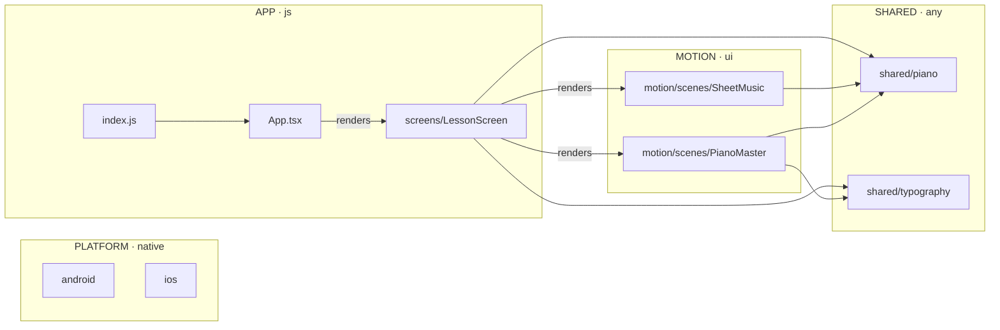

# Architecture

> Generated from the code by `npm run arch:build`. Everything between the `arch:generated` markers is rewritten on every build. Claude maintains the Conventions section at the end; the generator leaves it alone.

<!-- arch:generated:start -->

## 1. Overview

| Plane | Thread | Modules | Holds |
|---|---|---|---|
| AUDIO | audio | 0 | mic capture, playback, DSP, onset and pitch detection (native audio thread) |
| SYNC | any | 0 | shared clock, latency compensation, event stream (lock-free) |
| MOTION | ui | 2 | animation drivers, scenes and rendering (UI thread + GPU) |
| SHARED | any | 2 | types, utilities and music-theory tables usable from any thread |
| PLATFORM | native | 2 | iOS and Android projects and native modules |
| APP | js | 3 | screens, navigation, lessons, scoring, progress, storage (JS thread) |

**No problems.** Every rule passes, every module has a purpose, and every flow matches the code.

## 2. Modules

| Module | Kind | Plane | Thread | Purpose | Uses | Used by |
|---|---|---|---|---|---|---|
| `App.tsx` | entry | app | js | Root component: safe-area provider, hidden status bar and the lesson screen, full screen in landscape. | `screens/LessonScreen` | `index.js` |
| `android` | platform | platform | native | Android app project: Gradle build, MainActivity, manifest and native Android code | — | — |
| `index.js` | entry | app | js | Native entry point: registers the root App component with React Native. | `App.tsx` | — |
| `ios` | platform | platform | native | iOS app project: Xcode project, AppDelegate, Info.plist and native iOS code | — | — |
| `motion/scenes/PianoMaster` | scene | motion | ui | The piano's single source of truth on screen: draws a keyboard of any range (48 keys by default, 88, 108 or any other) with Skia, and owns the key state (which keys are lit, in which role) that lessons and the mic write to on the UI thread. | `shared/piano`, `shared/typography` | `screens/LessonScreen` |
| `motion/scenes/SheetMusic` | scene | motion | ui | The staff of a lesson, drawn with Skia and SMuFL music fonts: the staff with its clef, time signature and rests, the QuarterNotes component (heads, stems and duration bars) and the playhead. | `shared/piano` | `screens/LessonScreen` |
| `screens/LessonScreen` | screen | app | js | The lesson screen: background, top bar, staff and keyboard laid out exactly as the reference design, full screen in landscape. | `motion/scenes/PianoMaster`, `motion/scenes/SheetMusic`, `shared/piano`, `shared/typography` | `App.tsx` |
| `shared/piano` | module | shared | any | The piano model: notes, MIDI numbers, frequencies, keyboards of any size and key positions. Pure code, usable from any thread. | — | `motion/scenes/PianoMaster`, `motion/scenes/SheetMusic`, `screens/LessonScreen` |
| `shared/typography` | module | shared | any | The system fonts (SF Pro and SF Pro Rounded) and their metrics, so text can be placed by its baseline. React Native font family for SF Pro Rounded on iOS. | — | `motion/scenes/PianoMaster`, `screens/LessonScreen` |

## 3. Connections

Solid arrows are imports (labelled when a component is rendered); dashed arrows are JS → native calls.



## 4. Flows

_No flows yet. Add them to [flows.md](flows.md)._

## 5. Rules

| Rule | Status |
|---|---|
| Screens never touch audio internals or native modules. | ✓ |
| Features and audio are imported only through their public index.ts. | ✓ |
| Motion code may not import features, screens, state stores or audio; it uses other motion code, sync/ and shared/. | ✓ |
| Audio code has no UI imports. | ✓ |
| Code that runs every frame in motion never hands work back to the JS thread. | ✓ |
| Motion code takes durations and easing from tokens, not hard-coded numbers. | ✓ |
| Code on the UI or audio thread never imports JS-thread code. | ✓ |
| No circular imports anywhere. | ✓ |

## 6. File tree

```
App.tsx
android/app/src/main/java/com/pianoacademystudio/
  MainActivity.kt
  MainApplication.kt
index.js
ios/PianoAcademyStudio/
  AppDelegate.swift
src/
  motion/scenes/
    PianoMaster/
      PianoMaster.tsx
      drawKeyboard.ts
      index.ts
      keyboardLook.ts
      labels.ts
      pianoState.ts
      theme.ts
    SheetMusic/
      QuarterNotes.tsx
      drawQuarterNotes.ts
      drawStaff.ts
      index.ts
      paint.ts
      score.ts
      staffLook.ts
      useNotationTypefaces.ts
  screens/LessonScreen/
    LessonScreen.tsx
    drawLessonBackground.ts
    index.ts
    lessonDesign.ts
  shared/
    piano/
      index.ts
      keyboard.ts
      notes.ts
    typography/
      index.ts
```

<!-- arch:generated:end -->

<!-- arch:conventions:start -->
## 7. Conventions

_Claude keeps this list current: decisions that aren't obvious from file names alone._

- Every module (a folder with an `index.ts`, or a single file) starts with `/** @purpose … */`. Add `@thread ui|js|audio|native|any` when it differs from its plane's default.
- `graph.json` and the generated sections of this file are rebuilt automatically. Never edit them by hand.
- Data flows live in [flows.md](flows.md) and are checked against the code.
<!-- arch:conventions:end -->
